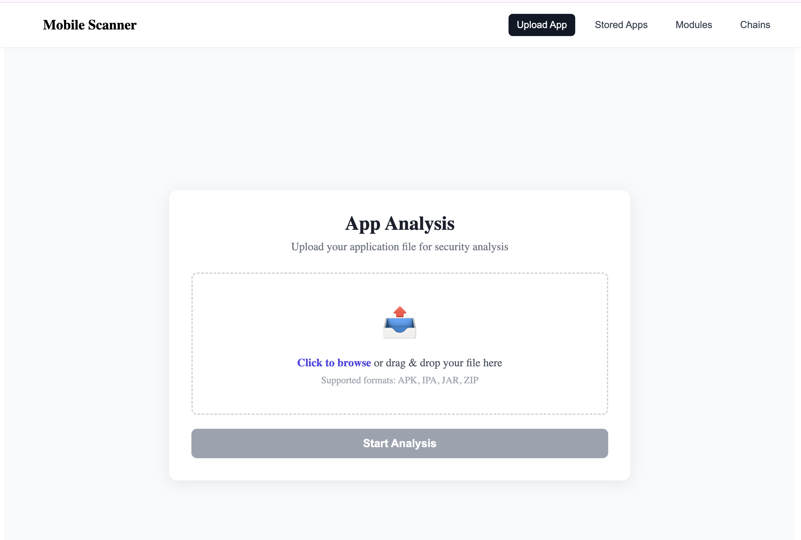
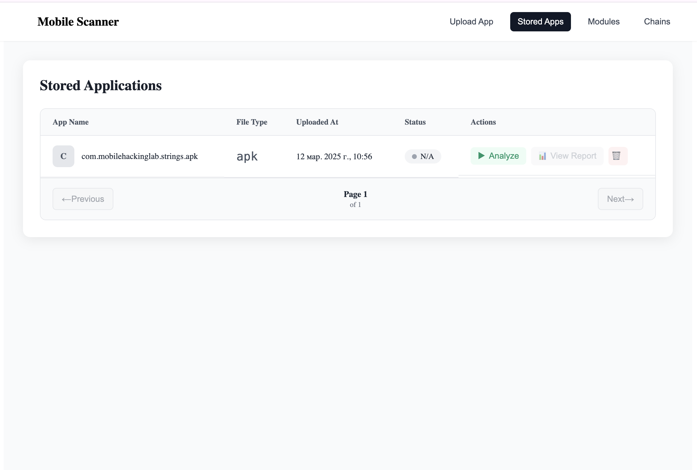
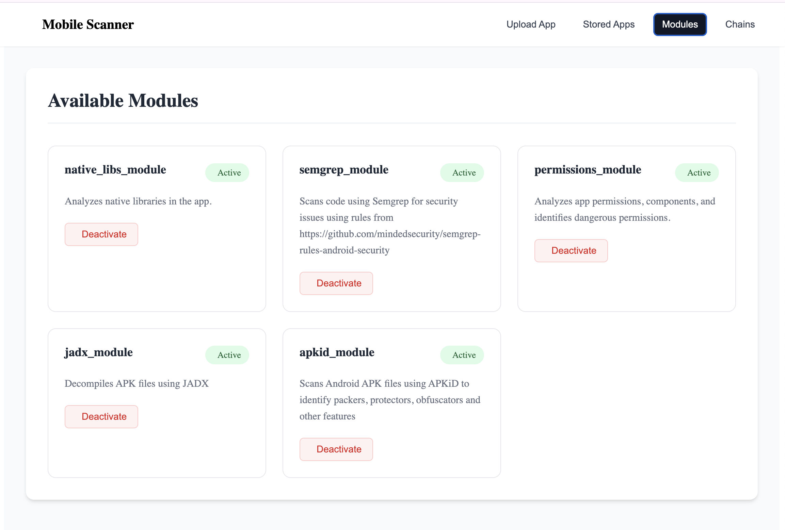
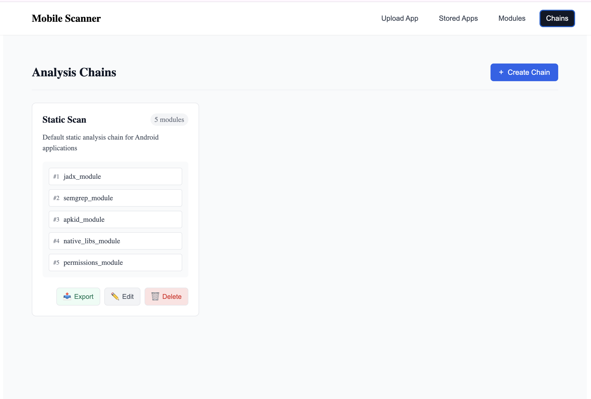
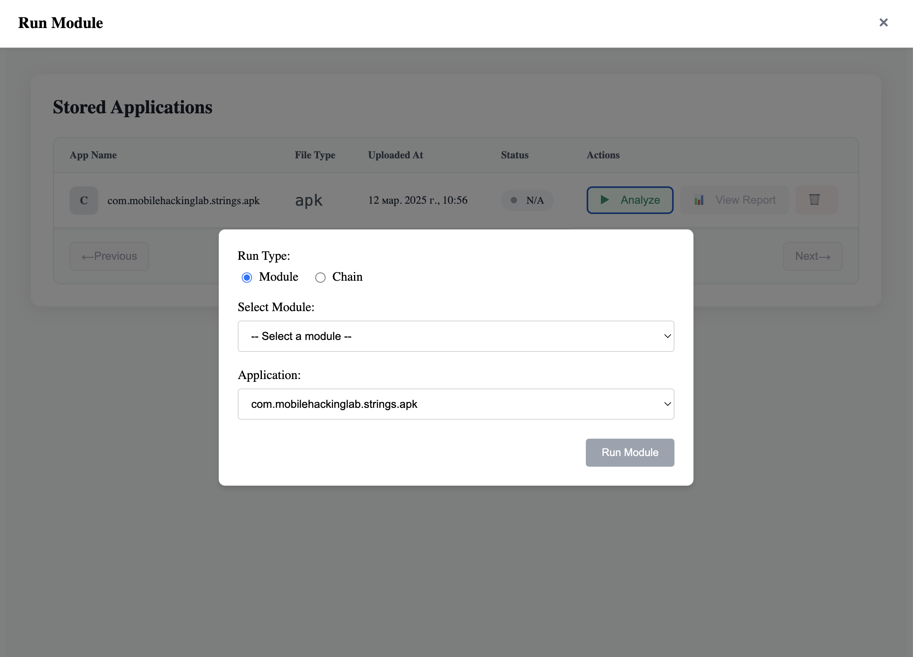
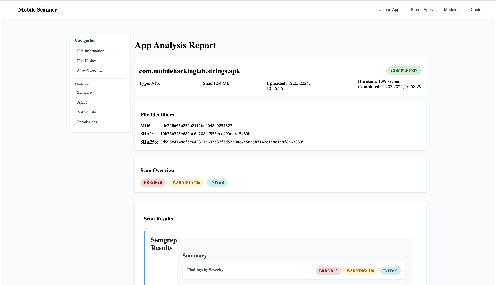
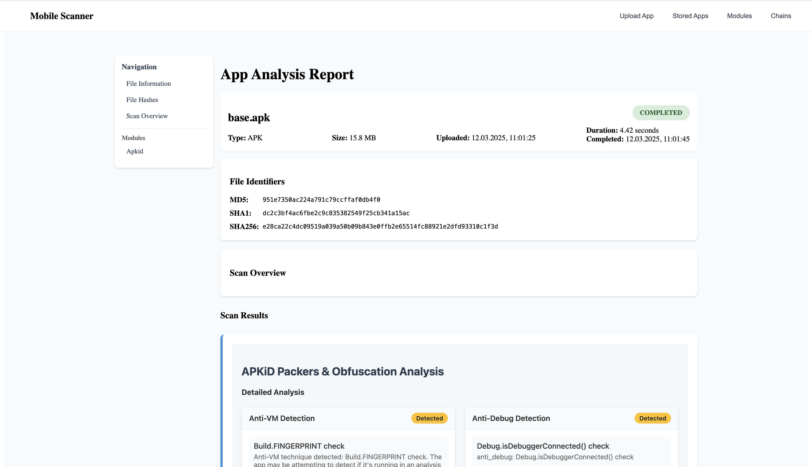
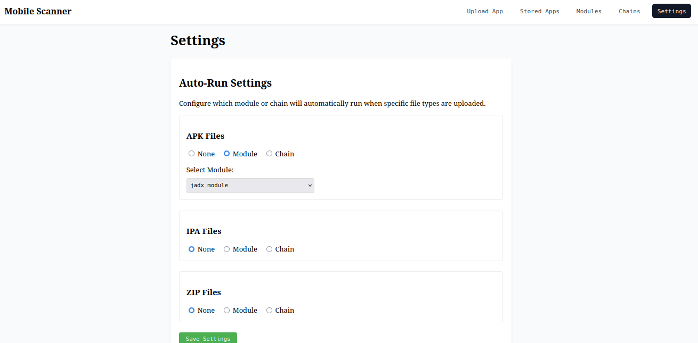
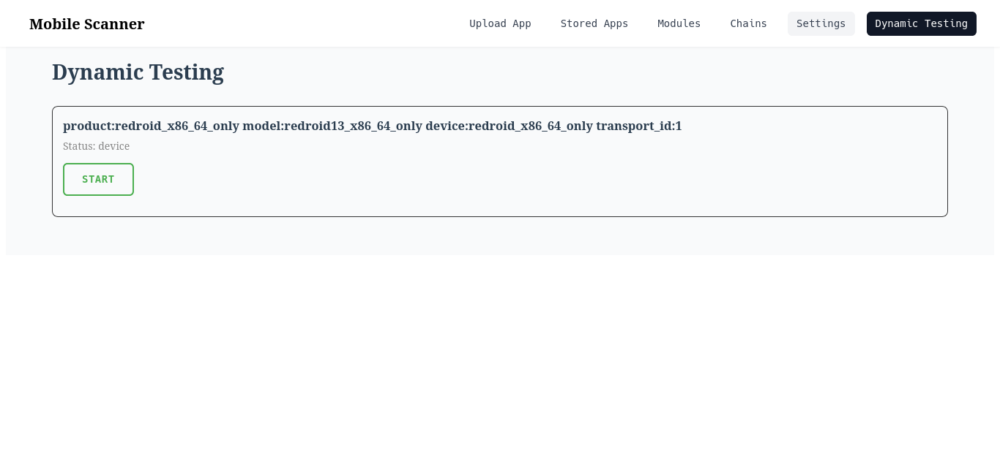
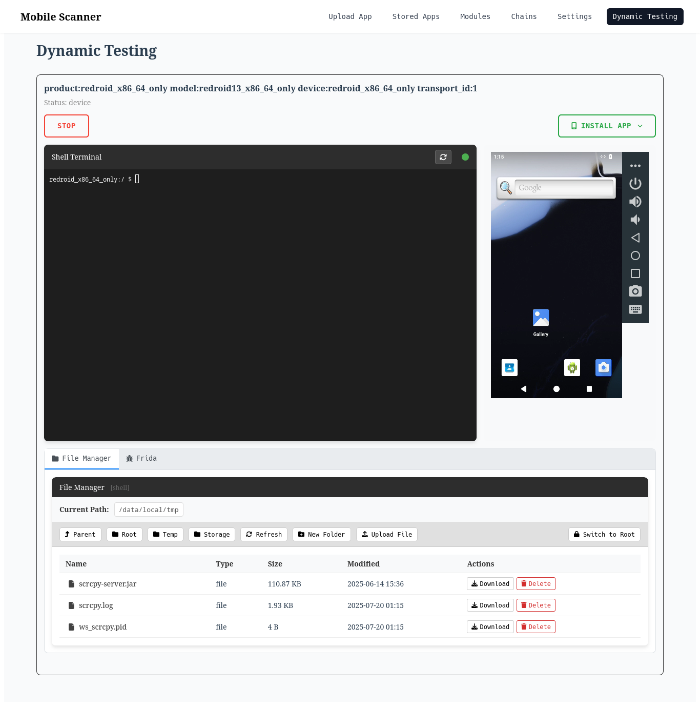

# Mobile Security Testing Platform



A modular platform for analyzing and security testing mobile applications. It is an alternative to [MobSF](https://github.com/MobSF/Mobile-Security-Framework-MobSF/) that is easier to customize and extend.

> [!WARNING]
> This project is under active development and has not been thoroughly tested. Expect bugs and breaking changes, and use it at your own risk.

## Features

### Module System
- Pluggable architecture with independent analysis modules
- Real-time module status monitoring
- Support for [custom modules](https://github.com/Stormtrooperroman/MobSec/blob/master/docs)

### Static Testing
- Analysis of APK files, IPA files, and source code

### Dynamic Testing
- Testing in a Dockerized Android environment
- Testing on a physical device

## Getting Started

### Requirements
- Docker ([installation guide](https://docs.docker.com/get-started/get-docker/))

### Installation

1. Clone the repository:

   ```bash
   git clone https://github.com/Stormtrooperroman/MobSec.git
   ```

2. Start the platform with Docker Compose:

   ```bash
   cd MobSec
   docker compose up -d --build
   ```

3. Open the web interface at http://127.0.0.1/. The Swagger UI is available at http://127.0.0.1:8000/docs.

## Interface









